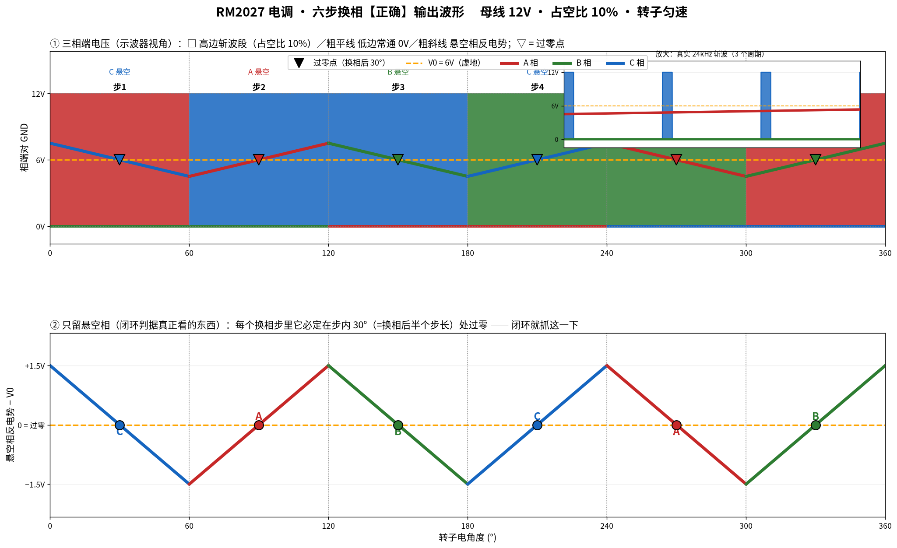
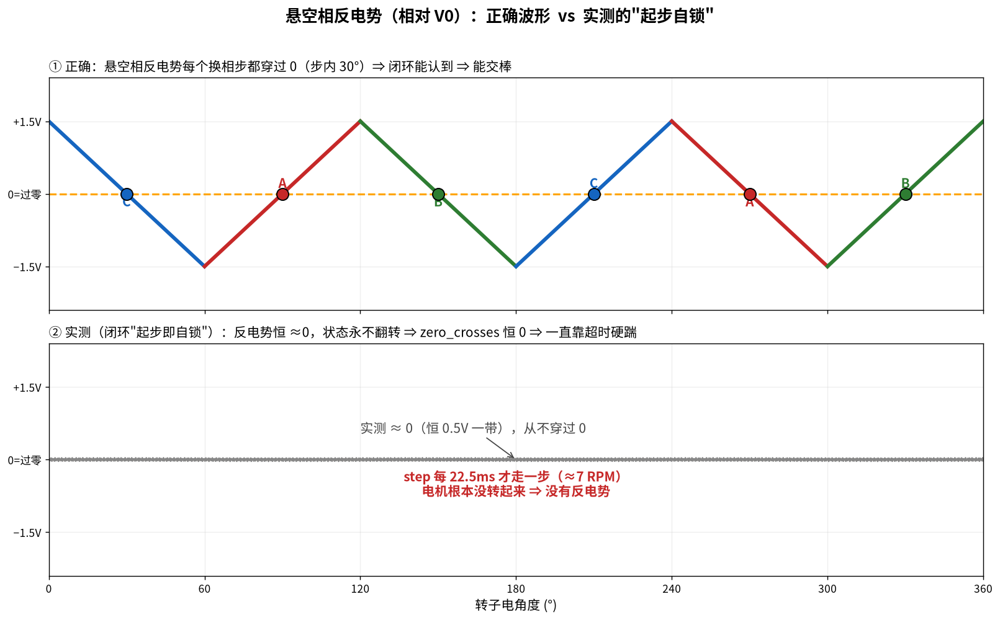

# RM2027 电调 · 闭环换相波形与起步（2026-10-08 整理）

配套固件分支：`1008-g071-closedloop-orthodox-startup`（提交 `f7988a1`）
波形生成脚本：`notes/waveform/gen5.py` → `notes/waveform/sixstep_correct.png`

---

## 一、正确的六步换相输出波形（这是对照基准）



**看波形的前提**：示波器夹的是**相端对 GND**，所以会同时看到三种东西：

| 该相此刻的角色 | 波形长什么样 |
|---|---|
| 高边斩波（PWM） | 一列 **12V 方块**，占空比 = 油门 |
| 低边常通 | 一条**平的 0V 线** |
| **悬空** | 一条**斜线**（就是反电势），从 12V 斜降到 0V 或反向 |

**三条要点**：

1. 任何时刻恰好一相悬空，且悬空相每 60° 换一个：**C → A → B → C → A → B**
   （对应 `comStep()` 的 step 1→6）。
2. 悬空相那段**不是平的**，是反电势斜线；**斜线中点 = 过零点**。
3. 过零发生在**换相后 30° = 半个换相步**处 —— 这是闭环唯一要抓的时刻。
   （`average_interval` 恰好等于 1 个换相步，所以 `average_interval>>1` 那个门槛
   正好压在真过零上，见下文第三节。）

**占空比 10% 时各段时长**（母线 12V、24kHz PWM、ARR=2665）：

```
一个换相步 = 60° 电角度；3700 机械 RPM(6 对极) 时 ≈ 450µs
  高边斩波段的平均电压 = 12V × 10% ≈ 1.2V
  悬空相斜率 = (Udc × D) / 2 ÷ (半步时长)  → 角度越慢斜率越缓
```

---

## 二、悬空相反电势（闭环判据真正看的东西）

见上图下半部分。每个换相步里，悬空相的反电势（相对虚地 V0）**必定在步内 30° 处过零**，
且相邻两步方向交替（上升 / 下降）。

对应代码：`adc_bemf.c` 的 `getCompOutputLevel()` —— 它把
`悬空相电压 − V0` 送进施密特（门槛 `BEMF_HYST_LSB` 码），翻转就是过零。

**把悬空相单独抽出来看，就是这张对照图**（上半 = 正确，下半 = 实测的自锁态）：



---

## 三、台架实测：闭环"起步即自锁"（问题定位）

### 现象（2026-10-08，F1 发 0→300 斜坡、母线 12V）

| 观测量 | 实测值 | 说明 |
|---|---|---|
| `duty_cycle` / `TIM1 CCR1` | 0→251→335（ARR=2665） | 占空比确实加上去了、PWM 在输出 |
| `step` | 1→2→3→4→5→6 循环，**每步 ~22.5ms** | 6 秒才走 6~7 个换相步 |
| `zero_crosses` | **恒 0** | 过零一次都没认到 |
| `bemf_timeout_happened` | 持续上涨 | 换相**完全**由 22.5ms 超时硬踹 |
| `bemf_state` / `edge_rise` / `edge_fall` | **恒 0** | 施密特状态从没翻转过 |

`step` 每 22.5ms 一步 ⇒ 机械转速 ≈ **7 RPM**。

> 复现"过零就在步内 30°、以及那条门槛的数值"的两个小脚本（已验证过）：
> `notes/netlist/sim_meas.py`（测过零相对换相的时刻）、
> `notes/netlist/sim_guard.py`（算 `average_interval>>1` 的物理值）。

### 根因（自锁）

```
过零判据门槛 BEMF_HYST_LSB = 4 码 ≈ 相侧 50mV ≈ 电机 ~300~500 RPM 才够

  7 RPM（超时硬踹能给的） ── BEMF ≈ 0mV ── ✗ 认不到
  3.7e3 RPM（开环斜坡能到的） ─ BEMF ≈ 1.5V ─ ✓ 认得到
                    ↑
             必须先有人把电机推到 300~500 RPM 以上
```

**开环**是 `olStepTick()` 按固定步频从 8 RPM 一路爬到目标速（不依赖反电势）⇒ 能过。
**闭环**的起步完全靠"认到过零才加速"⇒ 在 7 RPM 上认不到 ⇒ 永远爬不上去。

⇒ **缺的就是"开环那一脚"**（也就是 AM32 的经典起步）。

### 一条重要的排查结论

`stm32g0xx_it.c` 里那条下界门槛 `INTERVAL_TIMER->CNT > (average_interval >> 1)`：
`average_interval = e_com_time/3` 而 `e_com_time = 3 × 单个换相步`
⇒ **门槛恰好 = 0.5 个换相步，正好压在真过零那一刻** ⇒ 采样点落前一点就被
判成噪声丢掉、落后一点才认 ⇒ "时认时不认"。上游能这么写是因为它靠比较器 EXTI
**锁存边沿**；换成 ADC 每周期采电平后就不安全了。**本次已改为边沿检测并去掉该门槛。**

---

## 四、硬件核实（原理图/网表实算）

**① 三相采样网络完全对称** —— 软件过零可信：

```
MOTORA ─R1─┬─ VA(PA5)      MOTORB ─R3─┬─ VB(PA4)      MOTORC ─R5─┬─ VC(PA2)
           ├─R12─ GND                 ├─R11─ GND                 ├─R7─ GND
           └─R2─┬─ V0(PA3) ←三相共用   └─R4─┬─ V0               └─R6─ V0
                └─R4─ VB                    └─R3─ MOTORB
```

实算传递矩阵（单相 12V 激励）：

| 激励 | VA | VB | VC |
|---|---|---|---|
| MOTORA=12V | 0.682 | 0.204 | 0.204 |
| MOTORB=12V | 0.204 | 0.682 | 0.204 |
| MOTORC=12V | 0.204 | 0.204 | 0.682 |
| 三相同 12V | 1.091 | 1.091 | 1.091 |

⇒ 自比全为 0.0569、V0 系数全为 1/3 ⇒ `V0 = (VA+VB+VC)/3` 严格成立
⇒ "悬空相 − V0" 就是干净反电势。

**② 没有三相比较器通路**（硬约束）：

```
STM32G071 比较器输入：COMP1 只能 PA1/PA2/PA6 ；COMP2 只能 PA2/PA3
本板三相采样脚      ：VA=PA5  VB=PA4  VC=PA2  V0=PA3
                      ↑       ↑
                  不能进比较器  不能进比较器
```

只有 VC(PA2)、V0(PA3) 能进 COMP2 ⇒ **只能走软件过零**。

**③ 引脚勘误**：原理图上 A 相下管（U2 的 LIN1）画成 PB15 是**错的**，实际接 **PB1**。
代码里 `PHASE_A_GPIO_LOW` 一直是 PB1（与 `targets.h:4306` 那条注释一致）⇒ 代码无需改。

---

## 五、正交起步逻辑（改后）

```
解锁给油
  ↓
① 对齐     comStep(1) 钉住 ~200ms（把转子拉到已知位置）
  ↓
② 开环斜坡  固定时基硬踹，步长 OL_STEP_DIV_START(4000)→OL_STEP_DIV(9)
           油门 OL_INPUT_START(400)；不看过零
  ↓
③ 交棒     斜坡跑到底 + 累计认到 OL_STARTUP_ZC_NEED(=3) 次过零
           ⇒ ol_startup_arm=0、old_routine=0 ⇒ 此后由过零中断驱动换相
```

三段里**只有第 ③ 段需要反电势** —— 而那时电机已被踹到斜坡末端，反电势足够大。
安全：起步期过流跳闸；总时长上限 4000 000 拍后收油门停机。

---

## 六、通电后的验证清单

通电（母线 12V）后，用 SWD 读这几个量（地址以当前固件符号表为准）：

```bash
# 取地址
arm-none-eabi-nm obj/AM32_RM2027_ESC_G071_2.21.elf | grep -E \
  " (zero_crosses|ol_startup_arm|ol_steps|ol_step_div_cur|duty_cycle|actual_current|battery_voltage)$"
```

| 观测量 | 期望 | 不满足时的下一步 |
|---|---|---|
| `battery_voltage` | ≈1200（12V×100） | 母线没上电 |
| `ol_steps` | 给油后从 0 快速爬升 | 起步链没进（看 `ol_startup_arm`） |
| `ol_step_div_cur` | 4000 → 9 | 斜坡没跑完 |
| `ol_startup_arm` | 1 → **0**（交棒） | 一直 1 ⇒ 没认到过零 |
| `zero_crosses` | 从 0 开始涨 | 恒 0 ⇒ 看下一行 |
| `bemf_adc_va/vb/vc/v0` | 有几百码的摆动 | 摆动很小 ⇒ 采样点/续流期问题；摆幅够却认不到 ⇒ 降 `BEMF_HYST_LSB` |

SWD 快照脚本模板（openocd，注意 ST-Link 要走默认 hla_swd）：

```tcl
proc BU {a off} { expr {([mrw $a] >> ($off*8)) & 0xFF} }
proc HU {a off} { expr {([mrw $a] >> ($off*8)) & 0xFFFF} }
proc snap {} {
  halt
  echo [format "run=%d oldr=%d olarm=%d zc=%d | input=%d duty=%d cur=%d bat=%d" \
    [BU 0x2000060C 0] [BU 0x2000005C 0] [BU 0x2000060D 0] [mrw 0x20000608] \
    [HU 0x20000622 0] [HU 0x2000061C 0] [HU 0x2000065C 0] [HU 0x20000656 0]]
  resume
}
```

---

## 七、F1 测试板（DShot 信号源）

`rm2027-drone/test_esc` 是 STM32F103 冒充飞控发 DShot。状态机：

```
IDLE(发 0，让电调解锁) → RAMP(48→target, 3s) → HOLD(target)
```

**关键控制位**：`g_dbg.hold_zero`（`0x200001FC + 0x78 = 0x20000274`）

- 写 **1** ⇒ F1 一直发 DISARM(0)，电调可解锁（**每次重烧电调固件后都要这么复位一次**）
- 写 **0** ⇒ 立刻从斜坡起点给油

```bash
# 用 J-Link 写（必须显式 swd）
openocd -f interface/jlink.cfg -c "transport select swd" -f target/stm32f1x.cfg \
  -c "adapter speed 500" -c "init" -c "halt" -c "mwb 0x20000274 1" -c "resume" -c "shutdown"
```

⚠️ **踩过的坑**：电调只有在"油门连续为 0 约 1 秒"之后才会解锁。如果 F1 已经跑到
RAMP/HOLD（油门非 0）之后才复位/重烧电调 ⇒ 电调永远等不到那段零油门 ⇒ 永远不解锁。
做法：**先写 `hold_zero=1`，再复位/重烧电调**。

---

## 八、烧录 / 回退

```bash
# 编译（仓库内工具链路径不存在，用系统工具链）
cd ~/桌面/RM2027/AM32-rm2027
make RM2027_ESC_G071 ARM_SDK_PREFIX=/usr/bin/arm-none-eabi-

# 取 app 段（末尾 32B 是 FILE_NAME，止于 0x0800F800，不碰 EEPROM）
python3 -c "d=open('obj/AM32_RM2027_ESC_G071_2.21.bin','rb').read(); \
open('obj/app.bin','wb').write(d[:0x0800F800-0x08001000])"

# 烧写（ST-Link 不用 sudo）
openocd -f interface/stlink.cfg -f target/stm32g0x.cfg \
  -c "adapter speed 500" -c "init" -c "reset halt" \
  -c "flash write_image erase obj/app.bin 0x08001000" \
  -c "verify_image obj/app.bin 0x08001000" \
  -c "reset run" -c "shutdown"
```

- app 槽：`0x08001000`，59392 字节；EEPROM 在 **`0x0801F800`**（`devinfo` magic
  `5925e3da/4eb863d9`、`deviceInfo[4]=0x2b` 推出的地址）。
- 回退用的备份：`obj/backup_app_before_cl_1008_1848.bin`、`obj/backup_eeprom_1008_1848.bin`。
